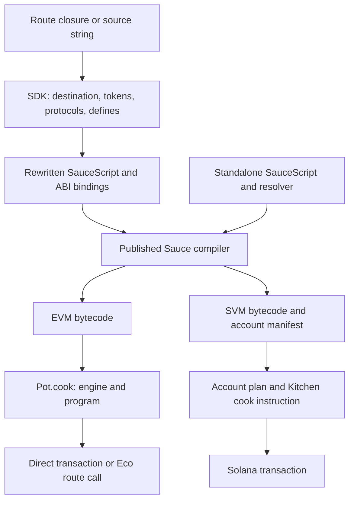

# SDK, compiler, and runtime

[Documentation](../README.md) · [Quick start](../guides/quick-start.md)

Sauce turns a program into an atomic on-chain execution. The SDK supplies chain and
protocol knowledge, the compiler translates SauceScript into bytecode, and a
compatible on-chain engine executes that bytecode. An Eco intent describes the
destination execution and the reward for fulfilling it.

## The three layers

| Layer    | Published surface                                                                  | Responsibility                                                                                                                             |
| -------- | ---------------------------------------------------------------------------------- | ------------------------------------------------------------------------------------------------------------------------------------------ |
| SDK      | `@eco-incorp/sauce` and its subpaths                                               | Protocol and token registries, route syntax, builders, intent encoding, account planning, transaction helpers, and settlement verification |
| Compiler | `@eco-incorp/sauce-compiler`; exposed in Node through `@eco-incorp/sauce/compiler` | Parse and check SauceScript, resolve modules and ABIs, apply compile-time parameters, and emit EVM or SVM bytecode                         |
| Runtime  | Deployed Sauce EVM/SVM engines and Kitchen/Pot contracts or programs               | Execute compatible bytecode against the chain's accounts and contracts                                                                     |

The compiler is included when you install `@eco-incorp/sauce`. Import
`@eco-incorp/sauce/compiler` to compile standalone programs, or use the SDK
route builders to resolve protocol and token names automatically.



Both compiler targets use Sauce bytecode. EVM output is not a Solidity contract's
deployment bytecode, and SVM output is not a Solana ELF program. The selected
Sauce engine interprets it.

## From global names to contract calls

Inside an EVM route, the SDK lets you write:

```js
USDC.approve(Uniswap.UniversalRouter, 1_000_000n);
```

The destination chain selects `USDC` and the router deployment. Before invoking
the compiler, the SDK rewrites token and protocol access into contract bindings,
supplies the matching ABIs, and injects scalar addresses. The compiler then sees
the equivalent `IERC20.at(...).approve(...)` call.

These names are SDK syntax, not builtins of the standalone compiler. A direct
`compile()` call needs explicit ABI imports/bindings and any addresses or defines
the program uses. See [protocols and tokens](../guides/protocols-and-tokens.md) and
[the compiler API](../api/compiler.md).

There are also separate host JavaScript and SauceScript environments. Importing
the SDK installs chain helpers such as `Base` in the host. A route callback is
read as source and compiled; it is never invoked as a JavaScript callback and
does not capture its surrounding variables. Generated TypeScript declarations
help you author route bodies, but compilation still resolves each name against
the selected destination's actual registry.

## From bytecode to execution

### EVM

`V12Pot.cook(address engine, bytes program)` runs one program. A Pot has an owner;
the engine is supplied on each cook. Constructing a call therefore needs both a
**Pot address** and an **engine address**. The SDK does not infer them from the
protocol namespace. The released engine accepts only canonical Pots deployed through
its configured Kitchen. Each cook must send the Kitchen's current `executionFee()`
in `msg.value`; the Pot remits it before running the program. Add native program
funding on top of that fee. An existing Pot balance does not replace this payment.

A multi-statement route body compiles to one program and one cook. To run separate
programs, construct separate calls and use an authorized execution mechanism that
propagates failures if the entire operation must be atomic. The caller must have
authority to invoke the Pot. For direct Eco route calls, the caller and required
Pot owner is the destination `Portal.executor()`. Keep funds in that shared Pot
only during the fulfillment; [intent setup](../guides/intents.md#prepare-the-destination-pot)
shows deployment, custody, and fee handling.

### SVM

The compiler returns an account manifest as well as bytecode. `Account` parameters
name attached slots; their `Writable` and `Signer` modifiers describe required
roles. Account identities and instruction data travel through separate channels.

The SVM SDK resolves account plans, builds instructions and transactions, and
supports Kitchen-managed code staging. Staged Kitchen execution uses finalized
metadata and code accounts. The built-in SVM route helper emits a legacy engine
instruction and is incompatible with the released engine; use the direct Kitchen
client described in the [Solana guide](../guides/solana.md).

The released engine's `execute_from_account` instruction names a code account;
its instruction data does not carry a content hash. A program hash checked during
Kitchen staging or cooking and the identity of the account later executed are
distinct evidence. See [settlement verification](../guides/verification.md#svm-verify-program-and-accounts).

## Intents connect executions across chains

`Base(() => { ... }, options).reward(reward)` creates an Eco intent whose route
executes on Base. The source chain and funding information come from the intent
options and reward. The SDK compiles the destination program, constructs the
route, and provides Portal calldata and hashes.

Building an intent does not publish, fund, or fulfill it. Those are transactions
submitted by the application and fulfillment actors. Nested intents are separate
executions composed with `.nest(...)`; they do not form one synchronous call
stack across chains. See [creating intents](../guides/intents.md).

## Compiler and engine compatibility

Compiler 2.3.0 identifies its output as `isaRevision: "stack-compact-v2"` and
reports the selected entry-argument format. These fields describe the artifact;
they do not inspect an address or negotiate runtime support.

Use `v12EngineAddress()`, `v12KitchenAddress()`, `v12SvmEngineProgramId()`, and
`v12SvmKitchenProgramId()` from `@eco-incorp/sauce/deployments` to obtain released
engine and Kitchen addresses. The legacy chain roster records an older
deployment and does not attest liveness of the pinned release. Check deployed
code, cluster, and instruction support on the target chain. Pair programs with the engine
release intended for them, and retain the compiler version, ISA revision, target,
and argument format with cached or staged artifacts.

Changing the compiler can change bytecode without changing the source-level API.
Settlement hash pins, compiled-program caches, and staged programs therefore
belong in a compiler upgrade's validation. The [verification guide](../guides/verification.md)
explains the SDK's current settlement pins.

Start with [SauceScript concepts](saucescript.md) for the language boundary, or
[compiling programs](../guides/compiling.md) for direct compiler integration.
